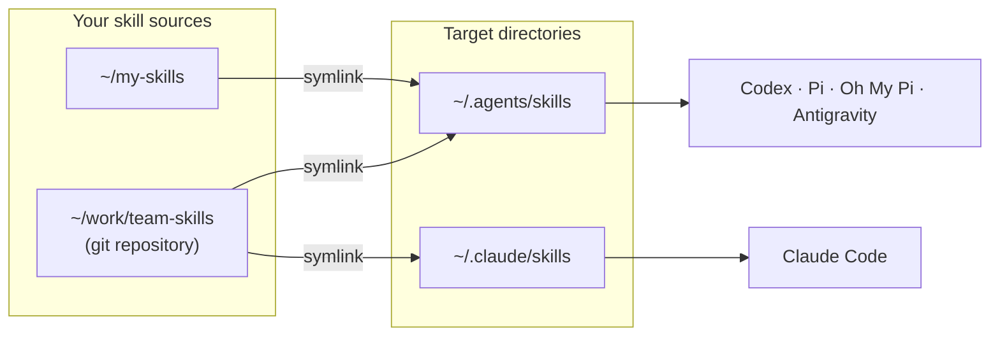
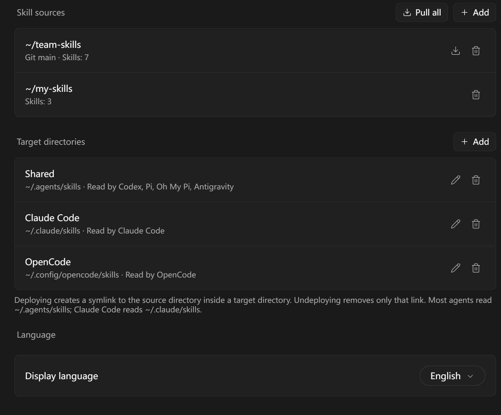
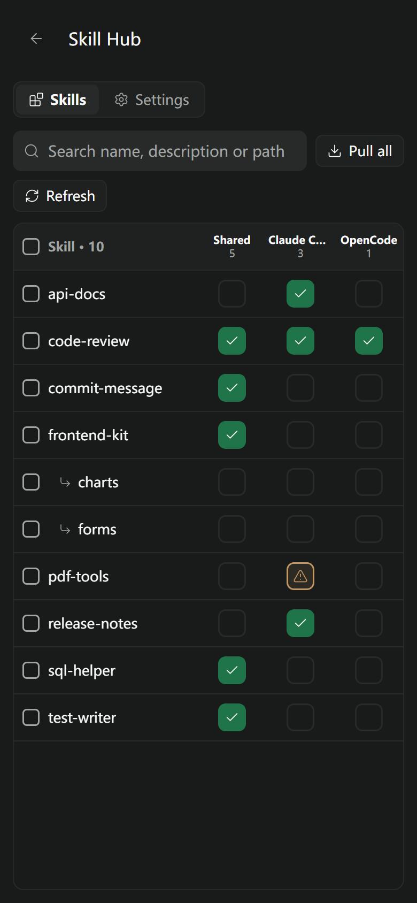

<div align="center">

# Skill Hub

**One place to decide which skills every coding agent can use.**

A [Paseo](https://paseo.sh) plugin that links your skill folders into the directories Claude Code, Codex, Pi, Oh My Pi, Antigravity and other agents read. No copies, no central store.

English · [简体中文](README.zh-CN.md)


[](LICENSE)


</div>

## Why

Every agent keeps its skills in its own folder. Copy one skill into five folders and you have five copies to keep in sync, with no easy way to tell which agent has which version.

Skill Hub keeps a single copy of each skill where it already lives, such as a git repository or a personal folder, and creates a symlink wherever an agent should see it. Edit or pull the source once and every agent gets the change.

## How it works



Most agents read the shared `~/.agents/skills`; Claude Code reads `~/.claude/skills`. Those two are the default targets, so a new install covers five agents with two columns.

## Features

- **Matrix view.** Skills are rows and target directories are columns. Tap a cell to deploy or undeploy, or select rows to deploy or undeploy many at once.
- **Finds skills anywhere.** Recursively discovers folders with a `SKILL.md`, including skills nested inside other skills, which appear indented under their parent.
- **Preview.** Tap a skill name to read its description and the rendered `SKILL.md`.
- **Status from disk.** Every refresh reads the file system. Existing symlinks, including relative ones, show as deployed; occupied names show as conflicts; dangling links are listed for cleanup.
- **Git sources.** Pull one repository from its row, or all of them with **Pull all**. Each repository reports its own progress and result.
- **Per host.** Settings are stored on each Paseo daemon, and all file operations run on the selected host.
- **Desktop, web and phone**, in English or Simplified Chinese, or following the system language.

<table>
  <tr>
    <td width="50%"></td>
    <td width="50%"></td>
  </tr>
  <tr>
    <td align="center"><sub>Preview a skill before deploying it</sub></td>
    <td align="center"><sub>Sources, target directories and language</sub></td>
  </tr>
</table>

<p align="center">
  
  &nbsp;&nbsp;
  
  <br>
  <sub>The same screens on a phone</sub>
</p>

## Reading the matrix

| Cell | Meaning | Tapping it |
| --- | --- | --- |
| ✅ Green check | Deployed: the target has a symlink to this skill | Removes that symlink |
| ⬜ Empty | Not deployed | Creates the symlink |
| ⚠️ Warning | Conflict: a folder, file or other link already uses this name | Explains the conflict; nothing is overwritten |
| 🔗 Broken link | A dangling link uses this name | Asks you to clean up broken links first |
| 📁 Folder | The original skill folder lives in this target | Nothing; it is not a link |

A **Duplicate** tag means two sources contain a skill folder with the same name. Both would use the same link name, so only one can be deployed to a target.

## Install

**Requirements**

- Paseo 0.17.4 or newer, on both the daemon and the app.
- Plugins enabled on the daemon: **Settings → Plugins → Enable plugins**.
- `git` on the daemon host, only if you want to pull git sources.

**From GitHub**

```bash
paseo plugin add github:LucasLan666666/paseo-skill-hub
```

Add `--host <host>` to install on a daemon other than your local one. A listing in the Paseo plugin registry is under review; once it is published you can install it from the registry as well.

## Quick start

1. Open **Skill Hub** from the sidebar, or press <kbd>⌘K</kbd> / <kbd>Ctrl+K</kbd> and type "Skill Hub".
2. In **Settings → Skill sources**, add a folder that contains skills, for example `~/skills` or a cloned repository.
3. Back on **Skills**, tap cells to deploy. Start a new agent session to pick up newly deployed skills.

Need another directory, such as `~/.config/opencode/skills` or `~/.copilot/skills`? Add it under **Settings → Target directories**; the dialog suggests known agent folders.

## Safe by design

- **Never overwrites.** An existing file, folder or foreign link shows as a conflict and is left alone.
- **Removes only links.** Undeploying deletes the symlink that points at that skill. Source files are never deleted.
- **Confirmed cleanup.** Broken links are listed first, and cleanup removes only those links.
- **Stays inside your sources.** Only folders inside a configured source can be linked or previewed, and symlinks inside a source are not followed out of it.
- **Careful pulls.** Pulling runs `git pull --ff-only`, so it never merges, rebases or discards local changes, and never prompts for credentials. Repositories rooted at your home directory or above are ignored.
- **Nothing extra.** No database, no service and no network requests other than your own git remotes. Settings live in Paseo's per-host plugin settings.

## FAQ

<details>
<summary><b>Claude Code does not see a skill I deployed.</b></summary>
<br>

Claude Code reads `$CLAUDE_CONFIG_DIR/skills` instead of `~/.claude/skills` when `CLAUDE_CONFIG_DIR` is set, and some provider setups set it. Add that directory as a target. Agents also tend to load skills when a session starts, so open a new session after deploying.
</details>

<details>
<summary><b>An agent lists a skill twice.</b></summary>
<br>

Some agents read more than one of the target directories. Deploy each skill to only one directory that a given agent reads.
</details>

<details>
<summary><b>How is this different from the Skills plugin?</b></summary>
<br>

The [Skills plugin](https://github.com/gpambrozio/paseo-plugins) lists and invokes the skills that a running session already has. Skill Hub decides which skills are on disk for every agent. They work well together.
</details>

<details>
<summary><b>Does deploying copy files?</b></summary>
<br>

No. Deploying creates a directory symlink, or a directory junction on Windows. Editing the source changes what every linked agent sees.
</details>

## Development

```bash
git clone https://github.com/LucasLan666666/paseo-skill-hub.git
cd paseo-skill-hub
npm install
npm run typecheck && npm test
paseo plugin install "$PWD"
paseo plugin reload skill-hub   # after changing the source
```

| Path | Contents |
| --- | --- |
| `index.client.tsx`, `client/` | Screen, matrix, preview and settings (React Native) |
| `index.server.ts`, `server/` | Discovery, linking and git pulls, running in the daemon |
| `shared/` | Settings schema and RPC contracts |
| `tests/` | Node test runner tests against real temporary directories |

## Acknowledgements

Inspired by [ryderme/skill-manager](https://github.com/ryderme/skill-manager).

## License

[MIT](LICENSE)
