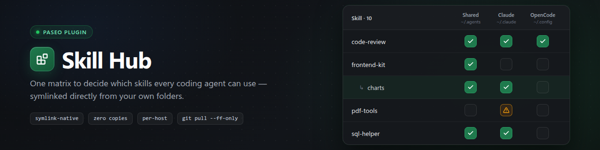
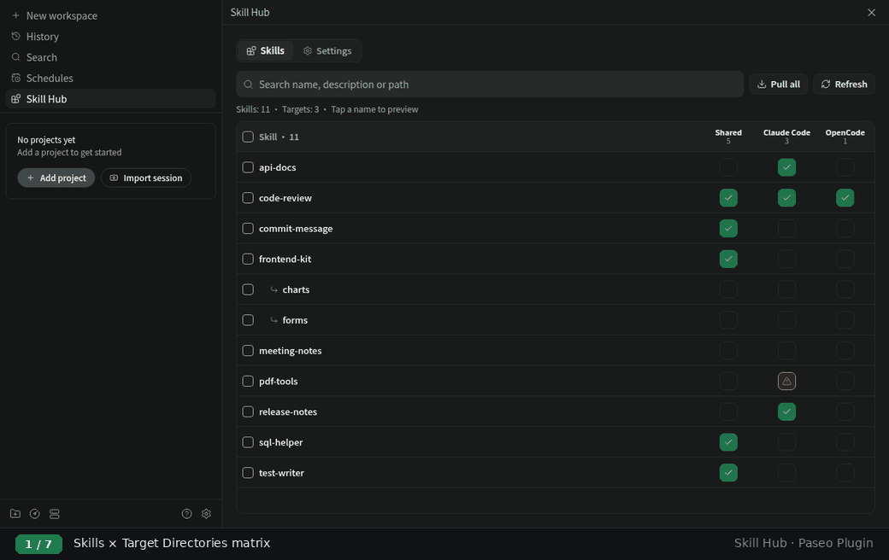
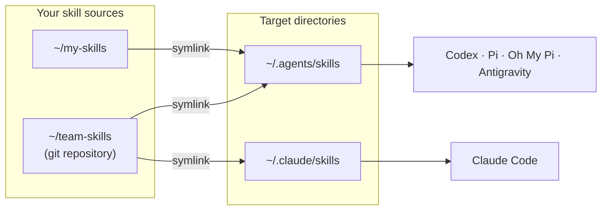
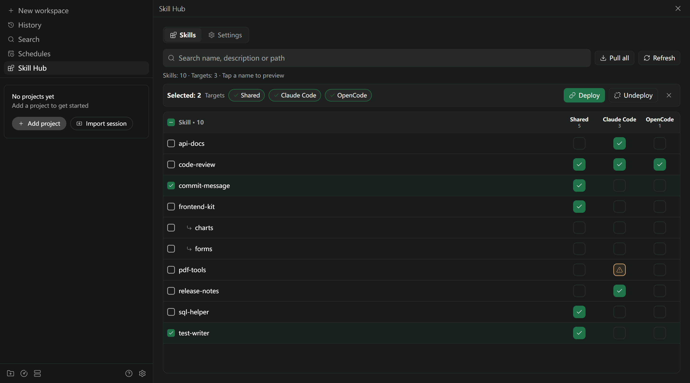
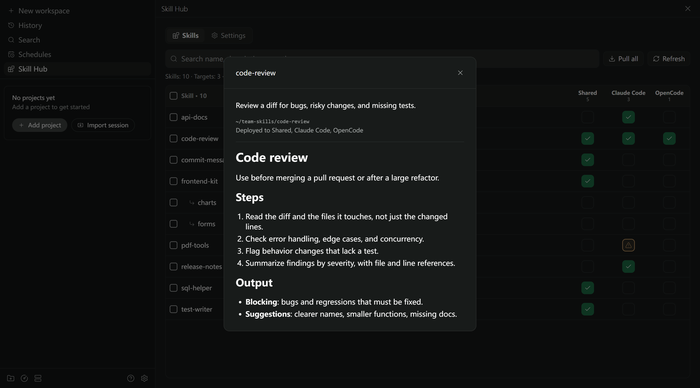
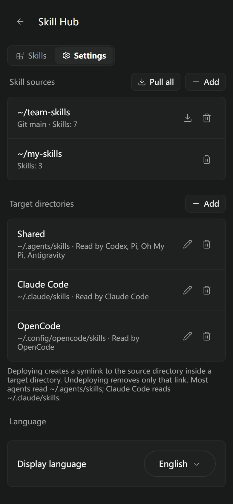

<div align="center">



<br>
<br>

**English** · [简体中文](README.zh-CN.md)

[](https://paseo.sh)
[](https://paseo.sh/plugins)
[](#features)
[](#configuration)
[](package.json)
[](LICENSE)

<br>

*Manage which skills Claude Code, Codex, Pi, Oh My Pi, Antigravity, and other coding agents can use — from one symlink-backed matrix inside [Paseo](https://paseo.sh).*

[Features](#features) · [Install](#install) · [Quick start](#quick-start) · [Configuration](#configuration) · [Safe by design](#safe-by-design) · [FAQ](#faq)

</div>

---

## Live walkthrough

<p align="center">
  
  <br>
  <sub>Toggle single cells, batch-deploy nested skills, preview rendered <code>SKILL.md</code>, and fast-forward pull git sources — all reflected straight on disk.</sub>
</p>

## Why Skill Hub

Every coding agent reads skills from its own directory. Copying a skill into five agent folders leaves five copies to keep in sync, with no clear view of which agent sees which version.

Skill Hub keeps a single copy of each skill where it already lives — such as a team git repository or your personal folder — and creates a directory symlink wherever an agent should see it. Edit or pull the source once, and every linked agent picks up the change.

## How it works



Most agents read the shared `~/.agents/skills`; Claude Code reads `~/.claude/skills`. Those two are the default targets, so a fresh install covers five agents with two columns.

## Features

- **Matrix view.** Skills are rows and target directories are columns. Tap a cell to deploy or undeploy, or select multiple rows for batch deploy/undeploy across chosen targets.
- **Recursive discovery with nested skills.** Walks configured sources up to 6 levels deep (skipping hidden folders, `node_modules`, and symlinks) to find every folder containing `SKILL.md`. Skills nested inside another skill appear indented under their parent and deploy independently.
- **Built-in `SKILL.md` preview.** Tap any skill name to inspect its frontmatter description, source path, active targets, and rendered Markdown before deploying.
- **Live filesystem truth.** Every refresh reads disk directly. Existing symlinks (including relative links) show as deployed; occupied paths show as conflicts; dangling links are surfaced for confirmed cleanup.
- **Safe git pulls.** Pull a single repository from its row in Settings, or update all git sources at once with **Pull all**, with per-repository progress and result feedback.
- **Persistent per-host settings.** Each daemon host keeps its own sources, target directories, and language in a local JSON file that survives uninstalling and reinstalling the plugin. All file operations run on the currently selected host.
- **Cross-platform & bilingual UI.** Works on Desktop, Web, and Mobile in English, Simplified Chinese, or following the system language.

## Screenshots

<p align="center">
  
  <br>
  <sub>Desktop matrix view with nested skills, conflict indicator, and batch selection</sub>
</p>

<table>
  <tr>
    <td width="50%"></td>
    <td width="50%"></td>
  </tr>
  <tr>
    <td align="center"><sub>Preview a skill before deploying</sub></td>
    <td align="center"><sub>Skill sources, target directories, and language</sub></td>
  </tr>
</table>

<p align="center">
  
  &nbsp;&nbsp;
  
  <br>
  <sub>Responsive layout on mobile</sub>
</p>

## Reading the matrix

| Cell | Meaning | Tapping it |
| --- | --- | --- |
| ✅ Green check | **Deployed** — the target holds a symlink to this skill | Removes that symlink |
| ⬜ Empty | **Not deployed** | Creates the symlink (and creates the target directory if missing) |
| ⚠️ Warning | **Conflict** — a folder, file, or link to another path already uses this name | Explains the conflict; nothing is overwritten |
| 🔗 Broken link | **Dangling symlink** uses this name | Prompts you to clean up broken links first |
| 📁 Folder | **Original source** — the skill folder itself lives inside this target | No-op; never deletes original directories |

A **Duplicate** tag indicates that two configured sources contain a skill folder with the same directory name. Because both would occupy the same link name in a target directory, only one can be deployed to a given target.

## Install

### Requirements

- **Paseo ≥ 0.17.4** on both the daemon and the app.
- Plugins enabled on the daemon: **Settings → Plugins → Enable plugins**.
- `git` on the daemon host (only required if you use **Pull** / **Pull all** on git sources).

### From the Paseo plugin registry

Skill Hub is listed in the [Paseo plugin registry](https://paseo.sh/plugins). Install it from **Settings → Plugins** in the app, or from the command line:

```bash
paseo plugin add lucaslan666666/skill-hub
```

### From GitHub

To track the latest commit on `main` instead of the reviewed registry version:

```bash
paseo plugin add github:LucasLan666666/paseo-skill-hub
```

Add `--host <host>` to either command to install on a remote Paseo daemon. Your settings are kept when you switch between the two, or uninstall and reinstall (see [Configuration](#configuration)).

## Quick start

1. Open **Skill Hub** from the Paseo sidebar, or press <kbd>⌘K</kbd> / <kbd>Ctrl+K</kbd> and search `"Skill Hub"`.
2. Go to **Settings → Skill sources** and add a directory containing skills (e.g. `~/skills` or a cloned git repository).
3. Switch back to **Skills** and tap cells to deploy, or select multiple rows for batch deployment.
4. Start a new agent session so the agent picks up the newly linked skills.

## Configuration

Settings are stored per daemon host in a plain JSON file on that host:

| Platform | Location |
| --- | --- |
| Linux / macOS | `$XDG_CONFIG_HOME/paseo-skill-hub/config.json`, or `~/.config/paseo-skill-hub/config.json` when `XDG_CONFIG_HOME` is unset |
| Windows | `%APPDATA%\paseo-skill-hub\config.json` |

The file lives outside Paseo's plugin directory, so **uninstalling or reinstalling the plugin keeps your sources, targets, and language**. Delete the file to start from defaults. The exact path is shown at the bottom of **Settings**. Writes are atomic, and edits made on another client are detected rather than overwritten.

Upgrading from 0.1.x copies settings that Paseo stored for the plugin into this file the first time the new version starts.

### Default & known target directories

| Target directory | Default | Agents known to read it |
| --- | :---: | --- |
| `~/.agents/skills` (Shared) | ✓ | Codex, Pi, Oh My Pi, Antigravity |
| `~/.claude/skills` | ✓ | Claude Code |
| `~/.config/opencode/skills` | — | OpenCode |
| `~/.copilot/skills` | — | Copilot |
| `~/.omp/agent/skills` | — | Oh My Pi |
| `~/.pi/agent/skills` | — | Pi |
| `~/.gemini/config/skills` | — | Antigravity |

You can add any absolute path (including `~/…` or Windows paths) under **Settings → Target directories**; the add dialog suggests the directories above.

### Discovery & git behavior

- **Discovery limits:** Recursive walk up to **6 levels** deep (capped at 20,000 directories per scan), skipping hidden directories (`.…`), `node_modules`, and symlinked directories.
- **Git detection:** Any source located inside a git work tree can be pulled, except repositories rooted at your home directory (`~`) or above (dotfiles repos are ignored).
- **Display language:** `System` (follows Paseo/OS), `English`, or `简体中文`.

## Safe by design

- **Never overwrites.** Any existing file, folder, or symlink pointing elsewhere is flagged as a conflict and left untouched.
- **Removes only its own links.** Undeploying deletes only a symlink verified to point to that skill. Source folders are never modified or deleted.
- **Confirmed cleanup.** Dangling symlinks are listed for review, and cleanup removes only confirmed broken links directly inside configured target directories.
- **Confined to configured sources.** Only directories inside a configured source (verified via canonical `realpath`) can be linked or previewed; symlinks inside a source are never followed outside it.
- **Non-destructive, non-interactive pulls.** Git pulls run `git -c pull.rebase=false pull --ff-only` with `GIT_TERMINAL_PROMPT=0` and `GCM_INTERACTIVE=never`, preserving custom `core.sshCommand` settings (falling back to `ssh -o BatchMode=yes` when unset). It never merges, rebases, discards local edits, or blocks on prompts.
- **Zero extra runtime or network traffic.** Zero third-party runtime dependencies, no background service, and no network requests other than your own git remotes when you click pull.

## FAQ

<details>
<summary><b>Claude Code does not see a skill I deployed.</b></summary>
<br>

When `CLAUDE_CONFIG_DIR` is set (common with custom provider setups), Claude Code reads `$CLAUDE_CONFIG_DIR/skills` instead of `~/.claude/skills`. Add that path under **Settings → Target directories**. Also open a new agent session after deploying, since agents typically index skills at session startup.
</details>

<details>
<summary><b>An agent lists a skill twice.</b></summary>
<br>

Some agents read more than one skill directory (for example both `~/.agents/skills` and an agent-specific folder). Deploy each skill to only one directory that a given agent reads.
</details>

<details>
<summary><b>How is this different from the Skills plugin?</b></summary>
<br>

The [Skills plugin](https://github.com/gpambrozio/paseo-plugins) lists and invokes skills already available to a running session. Skill Hub manages which skills are linked on disk for every agent across your host. They complement each other cleanly.
</details>

<details>
<summary><b>Does deploying copy files?</b></summary>
<br>

No. Deploying creates a directory symlink on Linux/macOS or a directory junction on Windows. Editing or pulling the source immediately updates what every linked agent sees.
</details>

## Development

```bash
git clone https://github.com/LucasLan666666/paseo-skill-hub.git
cd paseo-skill-hub
npm install
npm run typecheck && npm test
paseo plugin install "$PWD"
paseo plugin reload skill-hub   # after changing source files
```

| Path | Contents |
| --- | --- |
| `index.client.tsx`, `client/` | React Native screen, matrix view, preview modal, settings, and i18n |
| `index.server.ts`, `server/` | Skill discovery, symlink management, frontmatter parsing, git pulls, and the persistent config store |
| `shared/` | Settings schema (`v2` with `v1` migration) and RPC contracts |
| `tests/` | Node test runner suite running against real temporary directories |

## Acknowledgements

Inspired by [ryderme/skill-manager](https://github.com/ryderme/skill-manager).

## License

[MIT](LICENSE)
