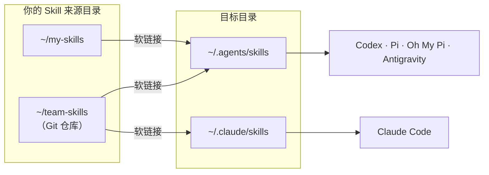

<div align="center">


<br>
<br>

[English](README.md) · **简体中文**

[](https://paseo.sh)
[-d97706?style=flat-square)](https://github.com/getpaseo/plugins/pull/3344)
[](#核心特性)
[](#配置说明)
[](package.json)
[](LICENSE)

<br>

*在 [Paseo](https://paseo.sh) 中用一张软链接矩阵，统一管理 Claude Code、Codex、Pi、Oh My Pi、Antigravity 等编程 Agent 可用的 Skills。*

[核心特性](#核心特性) · [安装指南](#安装指南) · [快速上手](#快速上手) · [配置说明](#配置说明) · [安全设计](#安全设计) · [常见问题](#常见问题)

</div>

---

## 功能演示

<p align="center">
  
  <br>
  <sub>单击单元格切换软链接、勾选多行批量部署嵌套 Skill、预览渲染后的 <code>SKILL.md</code>，以及一键拉取 Git 来源仓库——全部实时反映到磁盘。</sub>
</p>

## 为什么需要 Skill Hub

每个编程 Agent 都有自己读取 Skills 的目录。如果把同一个 Skill 复制到五个目录里，你就要维护五份副本，而且很难一眼看出哪个 Agent 正在用哪个版本。

Skill Hub 让每个 Skill 只保留一份，留在它原本所在的位置（例如团队 Git 仓库或个人目录），并在需要用到它的 Agent 目录里创建目录软链接。源文件改一次或拉取一次，所有链接到它的 Agent 都会立即看到变化。

## 工作原理



多数 Agent 都读取共享目录 `~/.agents/skills`，Claude Code 读取 `~/.claude/skills`。这两个就是默认目标目录，装好后两列即可覆盖五个 Agent。

## 核心特性

- **矩阵视图**：每行一个 Skill，每列一个目标目录。点击单元格即可部署或取消部署，也可以勾选多行，向选定目标批量部署或取消部署。
- **递归发现与嵌套子 Skill**：在已配置的来源目录中递归查找包含 `SKILL.md` 的文件夹（最多 6 层，跳过隐藏目录、`node_modules` 和软链接）；嵌套在 Skill 内部的子 Skill 会缩进显示在父级下方，并支持独立部署。
- **内置 `SKILL.md` 预览**：点击任意 Skill 名称，部署前即可查看 frontmatter 描述、源路径、已部署目标和渲染后的 Markdown 正文。
- **以磁盘状态为准**：每次刷新直接读取文件系统。已有软链接（包括相对链接）自动识别为已部署；同名占用标记为冲突；失效链接集中列出供确认后清理。
- **安全的 Git 来源拉取**：在设置中可逐个仓库拉取，也可点击「全部拉取」一次更新所有 Git 来源，每个仓库独立展示进度与结果。
- **按 Host 独立配置**：配置保存在各个 Paseo daemon 主机上，所有扫描、链接和拉取操作都在当前选中的 Host 上执行。
- **多端适配与双语界面**：支持桌面端、网页端和移动端，界面语言可选 English、简体中文或跟随系统。

## 界面截图

<p align="center">
  
  <br>
  <sub>桌面端矩阵视图：嵌套子 Skill、路径冲突提示与批量勾选操作栏</sub>
</p>

<table>
  <tr>
    <td width="50%"></td>
    <td width="50%"></td>
  </tr>
  <tr>
    <td align="center"><sub>部署前预览 Skill 完整内容</sub></td>
    <td align="center"><sub>来源目录、目标目录与界面语言设置</sub></td>
  </tr>
</table>

<p align="center">
  
  &nbsp;&nbsp;
  
  <br>
  <sub>移动端自适应布局</sub>
</p>

## 矩阵图例

| 单元格 | 含义 | 点击行为 |
| --- | --- | --- |
| ✅ 绿色对勾 | **已部署** — 目标目录中存在指向该 Skill 的软链接 | 删除该软链接 |
| ⬜ 空白 | **未部署** | 创建软链接（目标目录不存在时自动创建） |
| ⚠️ 警告 | **路径冲突** — 目标路径已被普通目录、文件或指向别处的链接占用 | 说明冲突原因，绝不覆盖 |
| 🔗 失效链接 | **悬空软链接**占用了该名称 | 提示先清理失效链接 |
| 📁 文件夹 | **原始目录** — 该 Skill 本体就在当前目标目录中 | 无操作，不会删除原始目录 |

**重名**标签表示两个来源目录里出现了同名的 Skill 目录。由于它们在目标目录中会占用同一个链接名，同一目标下只能部署其中一个。

## 安装指南

### 环境要求

- **Paseo ≥ 0.17.4**（daemon 与客户端均需满足）。
- 已在 daemon 上启用插件：**设置 → 插件 → 启用插件**。
- daemon 主机已安装 `git`（仅在使用 Git 来源拉取功能时需要）。

### 从 GitHub 安装（立即可用）

```bash
paseo plugin add github:LucasLan666666/paseo-skill-hub
```

如需安装到远程 Paseo daemon，请加上 `--host <host>`。

> **Paseo 官方插件市场状态：** 已提交并处于**审核中**，审核 PR 为 [getpaseo/plugins#3344](https://github.com/getpaseo/plugins/pull/3344)（提交 Issue [#3343](https://github.com/getpaseo/plugins/issues/3343)）。审核通过并正式上架后，也可以直接通过官方插件市场安装。

## 快速上手

1. 从 Paseo 侧边栏打开 **Skill Hub**，或按 <kbd>⌘K</kbd> / <kbd>Ctrl+K</kbd> 搜索 `"Skill Hub"`。
2. 进入 **设置 → Skill 来源**，添加存放 Skills 的目录（如 `~/skills` 或已克隆的 Git 仓库）。
3. 切回 **Skills** 页，点击单元格即可部署，或勾选多行批量部署。
4. 新开一个 Agent 会话，让 Agent 加载刚刚链接的 Skills。

## 配置说明

配置由 Paseo 按 daemon 主机保存在内置插件设置中，无需额外数据库或外部配置文件。

### 默认与常用目标目录

| 目标目录 | 默认启用 | 读取该目录的 Agent |
| --- | :---: | --- |
| `~/.agents/skills`（通用） | ✓ | Codex、Pi、Oh My Pi、Antigravity |
| `~/.claude/skills` | ✓ | Claude Code |
| `~/.config/opencode/skills` | — | OpenCode |
| `~/.copilot/skills` | — | Copilot |
| `~/.omp/agent/skills` | — | Oh My Pi |
| `~/.pi/agent/skills` | — | Pi |
| `~/.gemini/config/skills` | — | Antigravity |

在 **设置 → 目标目录** 中可以添加任意绝对路径（支持 `~/…` 与 Windows 路径），添加对话框内置以上常用目录快捷建议。

### 发现与拉取规则

- **扫描范围**：递归最多 **6 层**（单次扫描上限 20,000 个目录），自动跳过隐藏目录（`.…`）、`node_modules` 和软链接目录。
- **Git 仓库识别**：位于 Git 工作树中的来源目录均支持拉取，但根目录位于用户主目录（`~`）或更上层的仓库（如 dotfiles 仓库）会被自动忽略。
- **界面语言**：可选「跟随系统」、「English」或「简体中文」。

## 安全设计

- **绝不覆盖**：已有文件、目录或指向其他位置的软链接会被标为冲突并保持原样。
- **只删自身链接**：取消部署仅删除经核实指向该 Skill 的软链接，绝不修改或删除源目录。
- **清理需确认**：失效软链接会先列出清单，确认后仅清理位于已配置目标目录直接子级下的悬空链接。
- **严格限定在来源目录内**：通过规范路径（`realpath`）校验，只有位于已配置来源目录下的目录才可被链接或预览，且扫描时不跟随软链接跳出来源目录。
- **克制的非交互式拉取**：执行 `git -c pull.rebase=false pull --ff-only`，并设置 `GIT_TERMINAL_PROMPT=0` 与 `GCM_INTERACTIVE=never`；若仓库配置了自定义 `core.sshCommand` 会予以保留，否则默认使用 `ssh -o BatchMode=yes`。绝不合并、变基、丢弃本地改动，也不会弹出交互式凭据提示。
- **零多余依赖与静默流量**：零第三方运行时依赖、无独立后台进程，除点击拉取时访问你自己的 Git 远程地址外不发起任何网络请求。

## 常见问题

<details>
<summary><b>Claude Code 看不到我部署的 Skill。</b></summary>
<br>

当设置了环境变量 `CLAUDE_CONFIG_DIR` 时（常见于自定义 provider 配置），Claude Code 会读取 `$CLAUDE_CONFIG_DIR/skills` 而非 `~/.claude/skills`。请将该目录添加到 **设置 → 目标目录**。另外 Agent 通常在会话启动时索引 Skills，部署后请新开一个会话。
</details>

<details>
<summary><b>某个 Agent 里同一个 Skill 出现了两次。</b></summary>
<br>

部分 Agent 会同时读取多个目录（例如同时读取 `~/.agents/skills` 与自身专用目录）。针对同一个 Agent，每个 Skill 只部署到它读取的其中一个目录即可。
</details>

<details>
<summary><b>它和 Skills 插件有什么区别？</b></summary>
<br>

[Skills 插件](https://github.com/gpambrozio/paseo-plugins)用于查看和调用当前运行中会话已加载的 Skills；Skill Hub 负责管理磁盘上哪些 Skills 对哪些 Agent 可见。两者定位互补，可以搭配使用。
</details>

<details>
<summary><b>部署会复制文件吗？</b></summary>
<br>

不会。Linux/macOS 上创建目录软链接，Windows 上创建目录联接（junction）。修改或拉取源文件后，所有链接到它的 Agent 都会立即生效。
</details>

## 本地开发

```bash
git clone https://github.com/LucasLan666666/paseo-skill-hub.git
cd paseo-skill-hub
npm install
npm run typecheck && npm test
paseo plugin install "$PWD"
paseo plugin reload skill-hub   # 修改源码后重新加载
```

| 路径 | 说明 |
| --- | --- |
| `index.client.tsx`、`client/` | React Native 主页面、矩阵视图、预览弹窗、设置页与国际化 |
| `index.server.ts`、`server/` | Skill 发现、软链接管理、frontmatter 解析与 Git 拉取 |
| `shared/` | 按 Host 存储的配置 Schema（`v2`，含 `v1` 迁移）与 RPC 契约 |
| `tests/` | 基于 Node 测试运行器、在真实临时目录上执行的测试套件 |

## 致谢

灵感来自 [ryderme/skill-manager](https://github.com/ryderme/skill-manager)。

## 许可证

[MIT](LICENSE)
