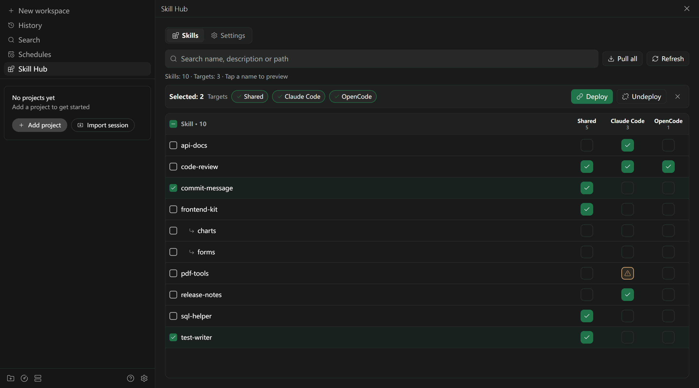
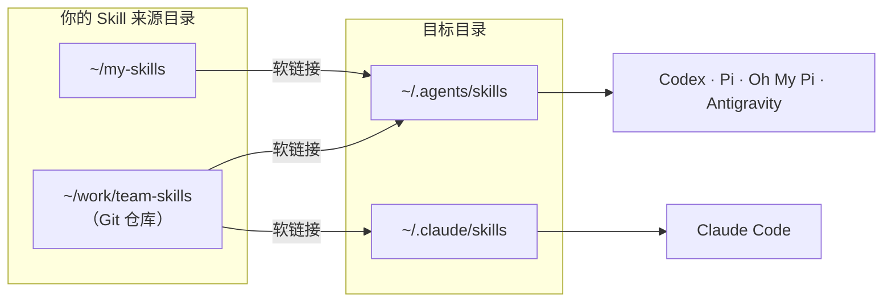
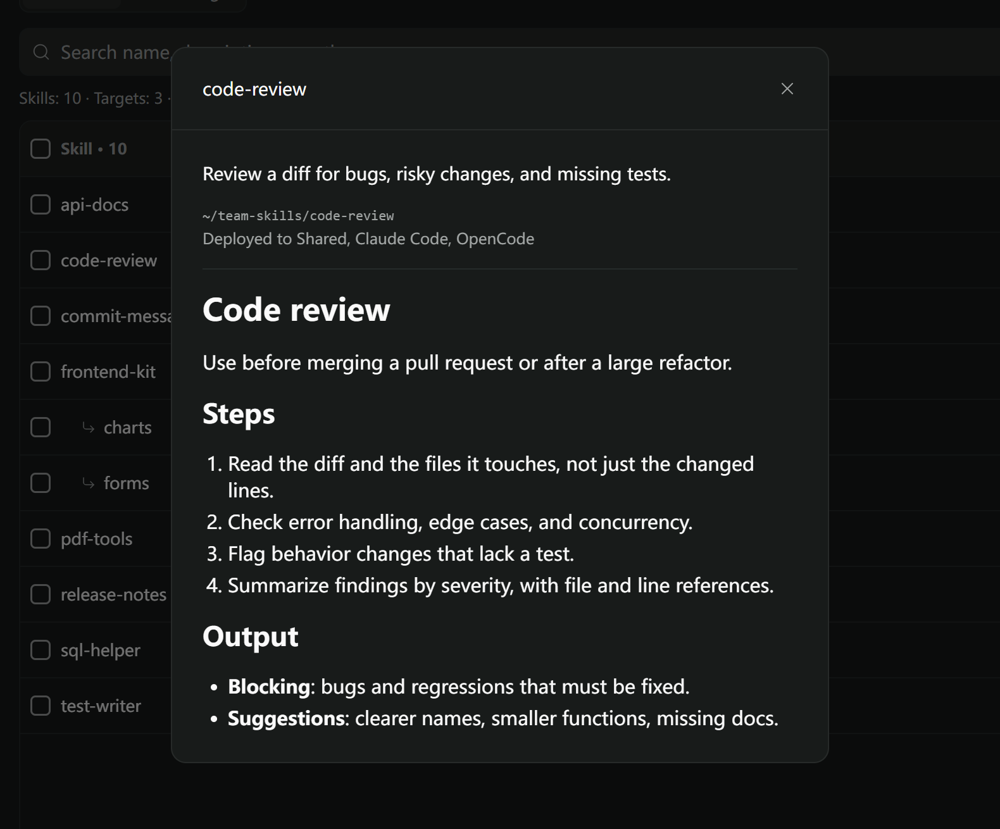
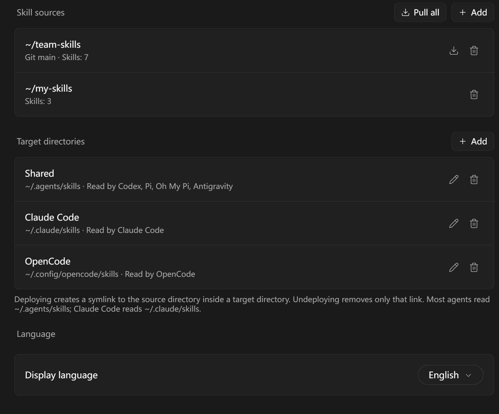
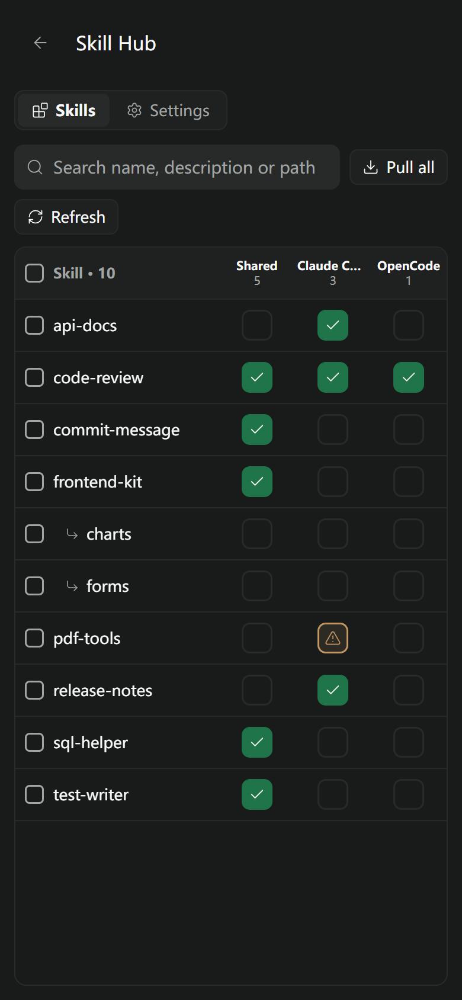
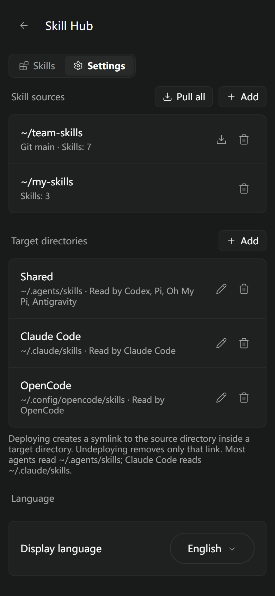

<div align="center">

# Skill Hub

**在一个地方决定每个编程 Agent 能用哪些 Skills。**

一个 [Paseo](https://paseo.sh) 插件：把你的 Skill 目录用软链接部署到 Claude Code、Codex、Pi、Oh My Pi、Antigravity 等 Agent 读取的目录里。不复制文件，也没有中心仓库。

[English](README.md) · 简体中文


[](LICENSE)



</div>

## 为什么需要它

每个 Agent 都有自己的 Skills 目录。同一个 Skill 复制到五个目录，就有五份副本要保持同步，而且很难看出哪个 Agent 用的是哪个版本。

Skill Hub 让每个 Skill 只保留一份，放在它原本所在的位置（比如某个 Git 仓库或你的个人目录），再在需要用到它的 Agent 目录里创建软链接。源文件改一次或拉取一次，所有 Agent 都能看到变化。

## 工作原理



多数 Agent 都读取共享目录 `~/.agents/skills`，Claude Code 读取 `~/.claude/skills`。这两个就是默认的目标目录，所以装好之后两列就能覆盖五个 Agent。

## 功能

- **矩阵视图**：每行一个 Skill，每列一个目标目录。点击单元格即可部署或取消部署；也可以勾选多行批量操作。
- **自动发现**：递归查找包含 `SKILL.md` 的目录，Skill 内部嵌套的子 Skill 也能找到，并缩进显示在父级下方。
- **内容预览**：点击 Skill 名称，查看描述和渲染后的 `SKILL.md`。
- **以磁盘为准**：每次刷新都读取文件系统。已有的软链接（包括相对链接）会识别为已部署；被占用的同名路径显示为冲突；失效链接会列出来供清理。
- **Git 来源**：可以在某个仓库那一行单独拉取，也可以用「全部拉取」一次拉取全部，每个仓库分别显示进度和结果。
- **按 Host 独立**：配置保存在每个 Paseo daemon 上，所有文件操作都在当前选中的 Host 上执行。
- **桌面、网页、手机**都能用，界面可选 English、简体中文或跟随系统。

<table>
  <tr>
    <td width="50%"></td>
    <td width="50%"></td>
  </tr>
  <tr>
    <td align="center"><sub>部署前先预览 Skill 内容</sub></td>
    <td align="center"><sub>来源目录、目标目录和语言设置</sub></td>
  </tr>
</table>

<p align="center">
  
  &nbsp;&nbsp;
  
  <br>
  <sub>手机上的同一组页面</sub>
</p>

## 矩阵图例

| 单元格 | 含义 | 点击后 |
| --- | --- | --- |
| ✅ 绿色对勾 | 已部署：目标目录里有指向这个 Skill 的软链接 | 删除这个软链接 |
| ⬜ 空白 | 未部署 | 创建软链接 |
| ⚠️ 警告 | 冲突：同名的目录、文件或指向别处的链接已经存在 | 说明冲突原因，不会覆盖任何内容 |
| 🔗 失效链接 | 同名位置是一个失效的链接 | 提示先清理失效链接 |
| 📁 文件夹 | Skill 的原始目录就在这个目标目录里 | 不做操作，它不是链接 |

标有「重名」的 Skill，表示两个来源目录里有同名的 Skill 目录。它们会用同一个链接名，所以同一个目标目录里只能部署其中一个。

## 安装

**前置条件**

- daemon 和 App 都是 Paseo 0.17.4 或更新版本。
- daemon 已启用插件：**设置 → 插件 → 启用插件**。
- daemon 所在主机装有 `git`（只有拉取 Git 来源时才需要）。

**从 GitHub 安装**

```bash
paseo plugin add github:LucasLan666666/paseo-skill-hub
```

要装到本机以外的 daemon，加上 `--host <host>`。Paseo 插件市场的上架申请正在审核中，发布后也可以从插件市场安装。

## 快速上手

1. 在侧边栏打开 **Skill Hub**，或按 <kbd>⌘K</kbd> / <kbd>Ctrl+K</kbd> 输入「Skill Hub」。
2. 在 **设置 → Skill 来源目录** 中添加一个包含 Skills 的目录，比如 `~/skills` 或某个克隆下来的仓库。
3. 回到 **Skills** 页，点击单元格部署。新部署的 Skill 一般要在新开的 Agent 会话里才会生效。

需要其他目录，比如 `~/.config/opencode/skills` 或 `~/.copilot/skills`？在 **设置 → 目标目录** 里添加即可，添加对话框里列有常用的 Agent 目录。

## 安全设计

- **从不覆盖**：已有的文件、目录或指向别处的链接会显示为冲突，保持原样。
- **只删链接**：取消部署只删除指向该 Skill 的软链接，从不删除源文件。
- **清理前确认**：失效链接会先列出来，清理时只删除这些链接本身。
- **不越出来源目录**：只有已配置来源目录里的 Skill 才能被链接或预览，来源目录里的软链接不会被跟随到外部。
- **谨慎拉取**：拉取使用 `git pull --ff-only`，不会合并、变基或丢弃本地修改，也不会弹出凭据提示。根目录为用户主目录或更上层的仓库会被忽略。
- **没有多余组件**：没有数据库、没有后台服务，除了你自己的 Git 远程地址外不发起任何网络请求。配置保存在 Paseo 按 Host 管理的插件设置里。

## 常见问题

<details>
<summary><b>Claude Code 看不到我部署的 Skill。</b></summary>
<br>

设置了环境变量 `CLAUDE_CONFIG_DIR` 时，Claude Code 读取的是 `$CLAUDE_CONFIG_DIR/skills`，而不是 `~/.claude/skills`；有些 provider 配置会设置这个变量。把那个目录添加为目标目录即可。另外，Agent 通常在会话开始时加载 Skills，部署后请新开一个会话。
</details>

<details>
<summary><b>某个 Agent 里同一个 Skill 出现了两次。</b></summary>
<br>

有些 Agent 会同时读取多个目标目录。对同一个 Agent，每个 Skill 只部署到它读取的其中一个目录即可。
</details>

<details>
<summary><b>它和 Skills 插件有什么区别？</b></summary>
<br>

[Skills 插件](https://github.com/gpambrozio/paseo-plugins)用来查看和调用某个运行中会话已经拥有的 Skills；Skill Hub 决定磁盘上有哪些 Skills 供所有 Agent 使用。两者可以搭配使用。
</details>

<details>
<summary><b>部署会复制文件吗？</b></summary>
<br>

不会。部署创建的是目录软链接（Windows 上是目录联接）。修改源文件后，所有链接到它的 Agent 都会看到变化。
</details>

## 开发

```bash
git clone https://github.com/LucasLan666666/paseo-skill-hub.git
cd paseo-skill-hub
npm install
npm run typecheck && npm test
paseo plugin install "$PWD"
paseo plugin reload skill-hub   # 修改源码后执行
```

| 路径 | 内容 |
| --- | --- |
| `index.client.tsx`、`client/` | 页面、矩阵、预览和设置（React Native） |
| `index.server.ts`、`server/` | 在 daemon 中运行的发现、链接和 Git 拉取 |
| `shared/` | 配置结构和 RPC 接口定义 |
| `tests/` | 基于 Node 测试运行器、使用真实临时目录的测试 |

## 致谢

灵感来自 [ryderme/skill-manager](https://github.com/ryderme/skill-manager)。

## 许可证

[MIT](LICENSE)
